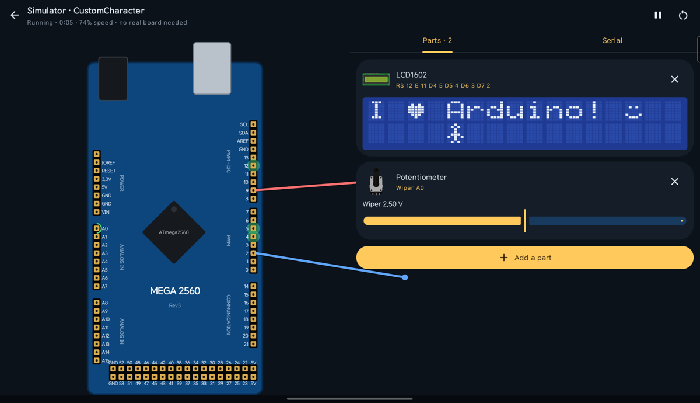
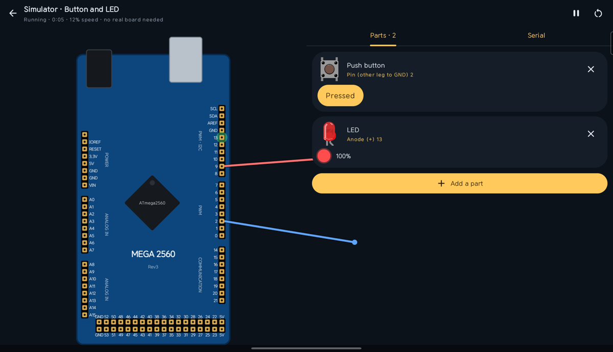
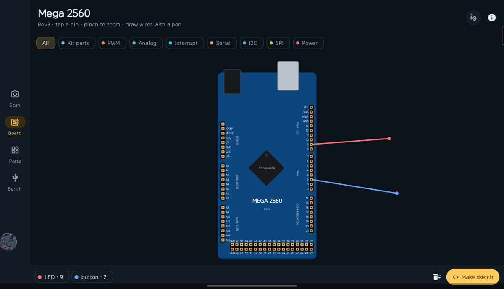
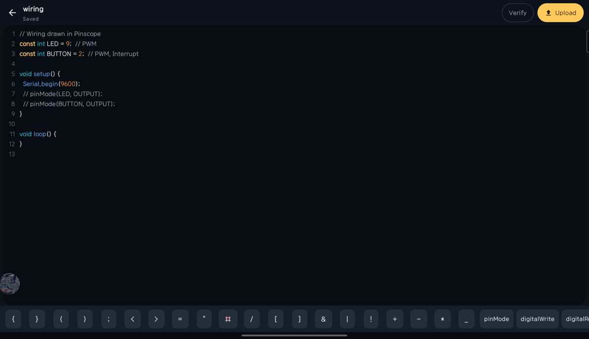
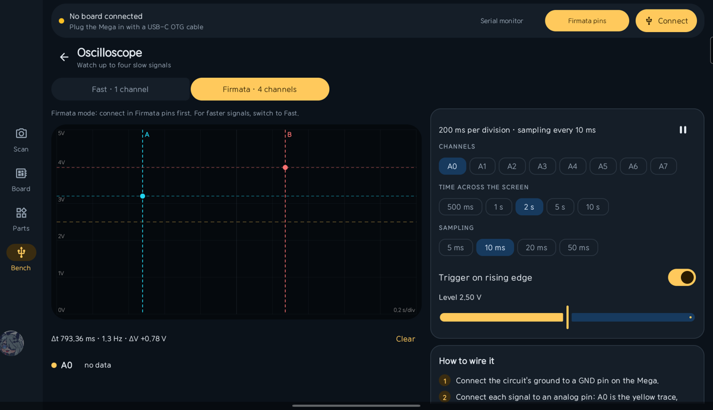
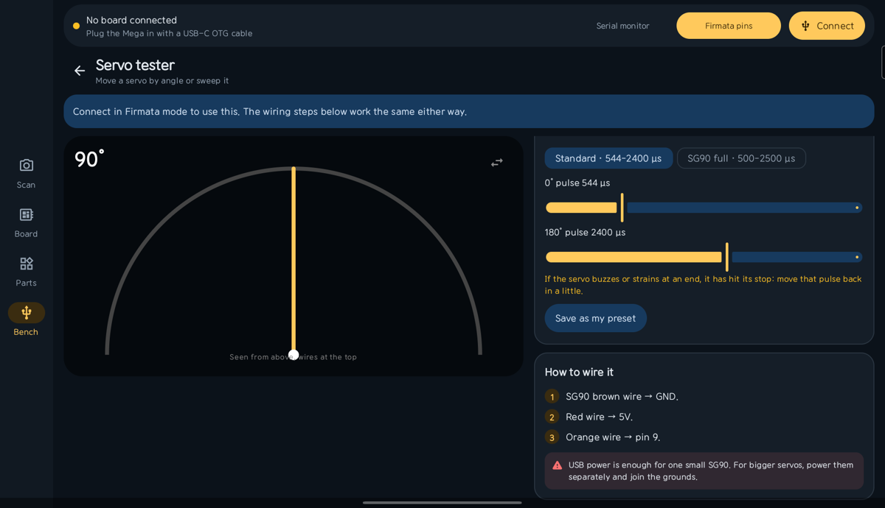
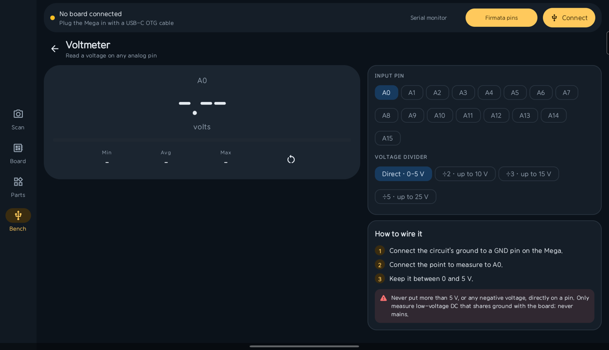

# Pinscope

An Android app for the Arduino Mega 2560: see every pin labelled on your real board through the camera, write and upload sketches from the phone, test them on a simulated Mega before risking hardware, and use the board as a voltmeter, oscilloscope and more.

## Features

- **Live pin overlay (AR):** point the camera at the board and all 86 header pins are labelled as you move. Tap a pin for what it does, its timer or interrupt, and which kit parts use it. Ships trained on the ELEGOO Mega; any other Mega is learned from one photo.
- **Board diagram and kit parts:** a to-scale Mega, filters for PWM, analog, interrupt, serial, I2C, SPI and power pins, and all 29 parts of the ELEGOO Mega starter kit with pinouts, wiring, resistors and datasheets.
- **Write and upload sketches on the phone:** a code editor and a real compiler (GCC 15) that runs on the phone, so Verify and Upload work offline. 179 Arduino and kit-library examples are ready to upload. The sketch already on the board is backed up first.
- **Simulator:** run any sketch on a simulated ATmega2560 with virtual parts: LEDs, buttons, sensors, displays, motors and I2C devices. Opening an example adds the parts it uses. It warns about mistakes that could damage a real board.
- **Bench (USB OTG):** serial monitor, plotter, and pin control through Firmata, with live pin states shown on the camera view.
- **Instruments:** voltmeter (calibrated), oscilloscope (77,000 samples a second, triggers, measurement cursors, a built-in signal generator and ready-made lab demos), logic monitor, PWM generator and servo tester.
- **Pen support:** draw wires on the board diagram and turn them into code, annotate board photos, hover over a pin to identify it, and place scope cursors. The pen's side button erases.
- **Phones and tablets:** tablets get a navigation rail and side-by-side panes.

| | | |
|---|---|---|
|  |  |  |
| Simulator: holding the button lights the LED | Wires drawn with the pen snap to pins | **Make sketch** turns them into code |
|  |  |  |
| Oscilloscope cursors measure time and voltage | Servo tester with pulse presets | Voltmeter with dividers and calibration |

## Requirements

- Android 12 or newer. The on-phone compiler needs a 64-bit ARM device (almost every phone and tablet since 2017).
- For the board features: an Arduino Mega 2560 (genuine with the ATmega16U2 USB chip, or a CH340 clone) and a USB-C OTG cable or adapter.
- The simulator, editor, examples and pin guide need no board at all.

## Install

Get the APK from [Releases](https://github.com/Eagle10021/Pinscope/releases) and open it on the device. From 0.1.1 on, Pinscope checks Releases when it starts and offers newer versions, betas included; it downloads and installs them itself.

## Documentation

- **[User guide](docs/GUIDE.md):** every screen, step by step.
- **[Developer guide](docs/DEVELOPING.md):** how Pinscope is built, tested and assembled from its data and tools.

## Credits

- Pin and kit data from [Mega Kit Pinouts](https://pinouts.01blue.org). Header positions from KiCad's Arduino Mega template.
- Part images in the simulator are from the [Fritzing parts library](https://github.com/fritzing/fritzing-parts) (CC BY-SA 3.0). They keep that licence; see `android/app/src/main/assets/parts/LICENSE.txt`.
- [OpenCV](https://opencv.org) (Apache 2.0) for board detection and tracking.
- The on-phone compiler is [Alpine Linux](https://alpinelinux.org)'s ARM64 packages of GCC and binutils for AVR (GPL), avr-libc (BSD) and musl (MIT), bundled as separate programs. Sources are in Alpine's repositories (`gcc-avr`, `binutils-avr`, `avr-libc`).
- The Arduino core and bundled libraries keep their own licences (LGPL, MIT, BSD, Unlicense, CC BY 3.0). StandardFirmata is LGPL 2.1. The Arduino IDE's built-in examples are public domain; library examples follow their library's licence.

Made by [Arshdeep Sahota](https://manifest.01blue.org). The app's own code is MIT licensed.
